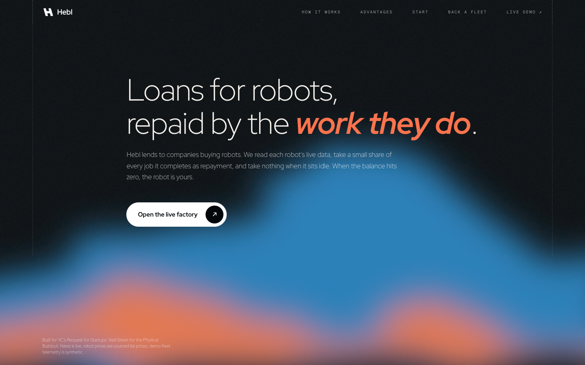
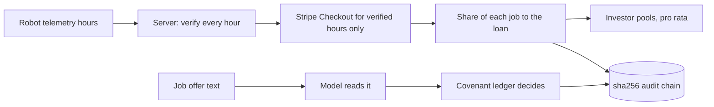

<div align="center">



# Hebl

*Loans for robots, repaid by the work they do.*

**[Live demo: selfmade-yc.vercel.app](https://selfmade-yc.vercel.app)** | [Operator desk](https://selfmade-yc.vercel.app/desk) | [Back a fleet](https://selfmade-yc.vercel.app/invest)


-635BFF)

</div>

Hebl lends to companies buying robots. Each robot's live telemetry proves the hours it worked; a share of every verified job repays the loan through Stripe, and nothing is due while the robot is idle. At zero, the operator owns the robot. Qualified investors can back pools of these loans and are paid from the same verified jobs.

Built at c0mpiled-18, the YC Startup School Hackathon in Taipei, for YC's Request for Startups **Wall Street for the Physical Buildout** (Brad Flora): "Today, banks underwrite a robot like a forklift." Not affiliated with Y Combinator.

## Try it in two minutes
| Step | Where | What you see |
|------|-------|--------------|
| 1 | Landing, "Try it" | Pick a real robot model (sourced list price) and see the advance, the share per job and the bank equivalent |
| 2 | `/desk`, Today | Yesterday's earnings, what went to lenders, what is down and what it costs |
| 3 | Fund a robot, then a job offer | The model reads the offer; covenant C1 blocks the $12/h job by name |
| 4 | Take the $31/h job, faked hours ticked | The server re-checks every telemetry hour and bills only verified ones |
| 5 | Trigger line jam | The 3D line stops like an e-stop, revenue drops, the repayment flexes down |
| 6 | `/invest` | Pools by robot type, a live payout feed, payouts pause for the jammed robot |

## Why it matters
- US equipment finance was **$1.51T** in 2025, 55.2% of equipment spend financed ([ELFA via SupplyChain247](https://www.supplychain247.com/article/industry_horizon_report_shows_equipment_finance_industry_expanded_to_1.5_trillion)).
- Physical AI startups raised **$47.4B** in H1 2026 ([Crunchbase](https://news.crunchbase.com/venture/physical-ai-funding-startups-robotics-aerospace-h1-2026/)), much of it equity spent on hardware.
- US industrial robot installs: **38,400** in 2025, +12% ([IFR](https://ifr.org/downloads/press_docs/EN-2026-SEP-24-IFR_Press_Release_WR-USA.pdf)).
- Since 28 Jul 2026 the FCC no longer authorizes new foreign-made mobile robots, humanoids and quadrupeds ([FCC DA 26-786](https://docs.fcc.gov/public/attachments/DOC-423682A1.pdf)). That changes what a robot is worth; our value index prices it [modelled].

## Who else is here
| Who | What they do | Gap |
|-----|--------------|-----|
| Banks, equipment lenders | Fixed loans, about 10.5% in our example | Same bill whether the robot works or not |
| Formic | Robots as a service with financing bundled | An operator, not a lender |
| USD.AI + Aravolta (YC) | GPU loans priced on live telemetry | GPUs only |
| Stripe Capital | Repayment as a share of sales | Card sales, not machine output |

In our scan on 11 Nov 2026 we did not find a lender pricing robot loans on live telemetry with repayment taken per job. That is a search result, not proof.

## How it works

| Stage | What it does | Code |
|-------|--------------|------|
| Verify | Split-conformal band on energy vs cycles, run on the server | `lib/engine.ts` `settleHours`, `app/api/checkout/route.ts` |
| Settle | The desk posts telemetry hours, not an amount; verdicts and a sha256 of the hours go into the Stripe session metadata; each session settles once | `app/api/checkout/route.ts`, `app/desk/page.tsx` |
| Price | Value from depreciated list price, verified income, health and FCC status [modelled] | `robotValue` |
| Lend | Advance 60% of value, one flat 12% fee, 8 to 30% of each job | `offerLoan`, `applyPayment` |
| Govern | Covenants in code; a change needs two distinct approvers | `checkJob`, `canChange` |
| Market | Live robotics news moves a resale index per robot type; weights are ours | `lib/market.ts`, `app/api/market/route.ts` |

## The numbers
Run `node scripts/eval.ts` (deterministic, synthetic telemetry):

| Case | Flagged | Meaning |
|------|---------|---------|
| Fraud: idle robot billed as busy | 500/500 (100%) | caught |
| Fraud: cycles with no energy behind them | 500/500 (100%) | caught |
| Fraud: energy faked to match cycles | 6/500 (1.2%) | **slips through**: this band alone cannot stop it |
| Honest: normal physics | 4/500 (0.8%) | false flags |
| Honest: worn motor, +15% energy | 379/500 (75.8%) | **would wrongly block real work**: the band needs per-robot recalibration |

The last two fraud and drift rows are the honest limits of a single physics band. Next steps: per-robot calibration, cross-checks with job output (counted picks, client confirmation) and a second sensor.

## What is real, what is simulated
| Layer | Status |
|-------|--------|
| Robot models and list prices | Sourced list prices (`lib/models.ts`) |
| Robotics news feed | Live RSS; impact weights are ours [modelled] |
| Hourly rates, fleet, telemetry | [synthetic] |
| Server-side hour verification and billing | Real code |
| Stripe Checkout | Real code; test keys not yet set on the live site, so payments run in labelled simulated mode |
| Model reading offers | GMI Cloud when a key is set; offline parser otherwise, labelled on screen |
| Covenant two-person rule | Real code, but in the demo one browser clicks both approvals |
| Loan ledger and audit chain | Real sha256 chain, stored in the browser for the demo |
| Investor pools (`/invest`) | Demo only, not an offer; yields [modelled] |
| 3D factory | Illustration of the operator view |

## Run it locally
```bash
npm install
cp .env.example .env.local   # optional: GMI, OpenRouter, Stripe test keys
npm run dev
```
| Task | Command |
|------|---------|
| Test | `npm test` |
| Oracle table | `node scripts/eval.ts` |
| Build | `npm run build` |

## Stack
Next.js 16, React 19, Tailwind 4, three.js with react-three-fiber, drei and postprocessing, Stripe, GMI Cloud (OpenAI-compatible). Fonts: Red Hat Display, Geist Mono.

## Repository layout
| Path | What |
|------|------|
| `lib/engine.ts` | Every money decision: oracle, settlement, value, loan, covenants, audit chain |
| `lib/models.ts`, `lib/market.ts`, `lib/photos.ts` | Sourced robot prices, news index, photo credits |
| `app/page.tsx`, `components/Hero.tsx` | Landing page, calculator, background |
| `app/desk/page.tsx`, `components/Fleet3D.tsx` | Operator desk and 3D factory |
| `app/invest/page.tsx` | Back a fleet |
| `app/api/agent`, `app/api/checkout`, `app/api/market` | Model, payments, news |

## Known limits
No real robots yet; the pools take no money; the ledger lives in the browser; one physics band cannot catch a careful spoofer.

## Team
Karina Kalicka-Molin, Julian Mundelein.
