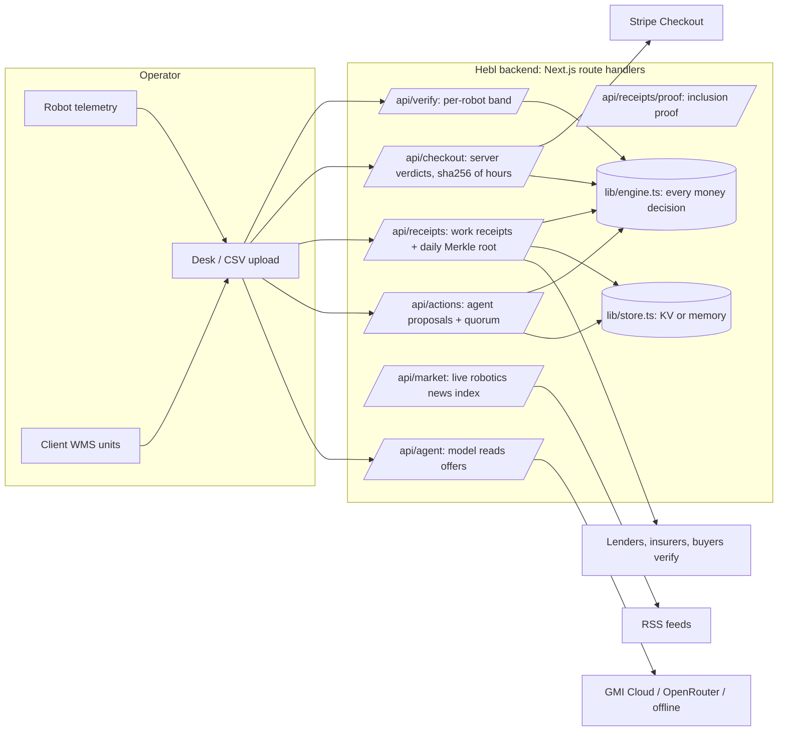
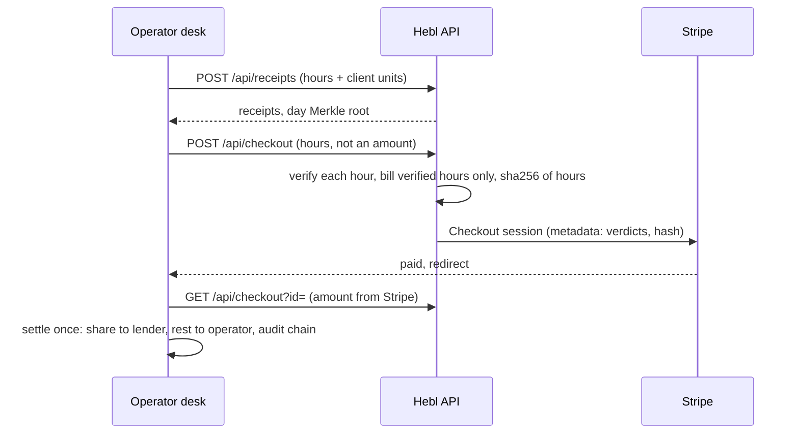
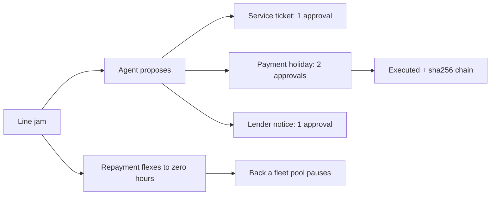

<div align="center">


**[Live demo](https://selfmade-yc.vercel.app)** | [Judges' guide](docs/JUDGES_GUIDE.md) | [See it run](https://selfmade-yc.vercel.app/pipeline) | [Operator desk](https://selfmade-yc.vercel.app/desk) | [Back a fleet](https://selfmade-yc.vercel.app/invest) | [Releases](https://github.com/KarinaKKarinaK/c0mpile-YC/releases)

   

</div>


## In one paragraph
Hebl lends to companies buying robots. Each robot's own telemetry proves the hours it worked, the client's warehouse system confirms the output, and a fixed share of every verified job repays the loan through Stripe. Nothing is due while the robot is idle; at zero, the operator owns it. Every verified hour becomes a hashed **work receipt** that rolls up into a daily Merkle root, so lenders, insurers and buyers can check a robot's work history without seeing raw data. Agents propose service tickets, payment holidays and lender notices; code bounds them and two people approve.

Built at c0mpiled-18, YC Startup School Hackathon, Taipei, for Brad Flora's RFS: "Today, banks underwrite a robot like a forklift." Not affiliated with Y Combinator.

## The numbers that matter
| | Number | Source |
|---|---|---|
| US equipment finance, 2025 | **$1.51T**, 55.2% of equipment spend financed | [ELFA via SupplyChain247](https://www.supplychain247.com/article/industry_horizon_report_shows_equipment_finance_industry_expanded_to_1.5_trillion) |
| Physical AI funding, H1 2026 | **$47.4B** | [Crunchbase](https://news.crunchbase.com/venture/physical-ai-funding-startups-robotics-aerospace-h1-2026/) |
| US industrial robot installs, 2025 | **38,400**, +12% | [IFR](https://ifr.org/downloads/press_docs/EN-2026-SEP-24-IFR_Press_Release_WR-USA.pdf) |
| FCC rule on foreign-made mobile robots | from **28 Jul 2026** | [FCC DA 26-786](https://docs.fcc.gov/public/attachments/DOC-423682A1.pdf) |
| Revenue-share lending at scale | **81,000+** businesses funded by Stripe Capital | Stripe 2025 annual letter |

## Fraud check, measured (`node scripts/eval.ts`, synthetic telemetry, 500 hours per row)

| Case | Flagged | Read it as |
|------|---------|-----------|
| Fraud: idle robot billed as busy | 500/500 | caught |
| Fraud: cycles with no energy | 500/500 | caught |
| Fraud: energy faked to match cycles | 6/500 | slips past one physics band |
| ... checked against the client's confirmed output | 500/500 | caught by the second, independent source |
| Honest: normal physics | 4/500 | false flags |
| ... with the client check | 13/500 | price of the extra check |
| Honest: worn motor, +15% energy | 379/500 | a fleet-wide band blocks real work |
| ... judged against its own fitted energy line | 10/500 | per-robot band fixes drift |

## Architecture


## A paid job, step by step


## When a robot breaks


## YC's ten questions, answered (also on the landing page, "Straight answers")
| # | Question | Answer |
|---|----------|--------|
| 1 | Founder fit | Fourth build where machines pay their own way (Zishi, Guild, Arbiter). Adding an equipment-finance advisor. |
| 2 | Market | $1.51T US equipment finance; $47.4B into physical AI in H1 2026; robot installs +12%. |
| 3 | Acute | Fixed payments ignore uptime; one bad month breaks a young fleet; equity gets burned on hardware. |
| 4 | Competition | Equipment banks, Formic, USD.AI (GPUs), Stripe Capital (card sales). |
| 5 | Who wants it | Fleet operators financing hardware; lenders who cannot see robot earnings. CSV upload works today. |
| 6 | Why now | FCC rule (Jul 2026), record physical AI funding, robots stream telemetry, agents can run collections. |
| 7 | Proxies | Stripe Capital, USD.AI, aircraft and equipment lessors, revenue-based finance. |
| 8 | Years | Same thesis across four builds. |
| 9 | Scalable | Software fee on partner capital, then own credit line, then pools; receipts compound into pricing data. |
| 10 | Space | YC's own Winter 2027 RFS. |

## Jon Xu's test ("How to pick a startup idea")
| His point | Hebl |
|-----------|------|
| Pick one, burn the boats | One idea, one name, one customer: robot fleet operators |
| Could you run their business | The desk is their 8am check: earnings, sweep, downtime cost, what needs them |
| Edge of what AI can do | Agents propose operational and credit actions; verification and receipts keep them honest |
| Verticalize, own the outcome | Rails for licensed lenders first, then lend from our own book |
| Most ambitious version | The credit system for every machine that works; receipts are its credit history |

## API
| Route | Method | Does |
|-------|--------|------|
| `/api/verify` | POST | CSV of `cycles,kwh` per hour, fits a per-robot band at 30+ rows, returns verified hours and an offer |
| `/api/checkout` | POST, GET | Server-side billing from telemetry hours; Stripe session with verdicts and sha256; once-only settle |
| `/api/receipts` | POST, GET | Work receipts per hour; day Merkle root |
| `/api/receipts/proof` | GET | Inclusion proof for one receipt |
| `/api/actions` | POST, PATCH, GET | Agent proposals; approvals by distinct roles; sha256 chain |
| `/api/agent` | POST, GET | Model reads job offers and failure notes (GMI, OpenRouter, offline) |
| `/api/market` | GET | Live robotics news, scored into a resale index per robot type |

```bash
curl -X POST https://selfmade-yc.vercel.app/api/receipts -d '{"robotId":"R-06","hours":[{"cycles":100,"kwh":1.55,"units":100},{"cycles":5,"kwh":0.4}]}'
```

## What is real, what is simulated
| Layer | Status |
|-------|--------|
| Robot models and list prices | Sourced (`lib/models.ts`) |
| News feed | Live RSS; impact weights ours [modelled] |
| Verification, billing, receipts, Merkle proofs, agent quorum | Real code, tested |
| Storage | Vercel KV / Upstash when `KV_REST_API_URL` is set; otherwise in-memory per server instance (demo) |
| Stripe Checkout | Real code; test keys pending on the live site, so payments run in labelled simulated mode |
| Fleet, hourly rates, telemetry | [synthetic] |
| Two-person approvals | Real check on the server; in the demo one browser clicks both roles |
| Investor pools | Demo only, not an offer |

## Run it
```bash
npm install && cp .env.example .env.local && npm run dev
npm test                 # 11 tests
node scripts/eval.ts     # the fraud table above
```

## Layout
| Path | What |
|------|------|
| `lib/engine.ts` | Oracle, settlement, receipts, Merkle, agent rules, loans, covenants, audit chain |
| `lib/store.ts` | KV or memory storage |
| `app/api/*` | Backend routes above |
| `app/page.tsx`, `app/desk/page.tsx`, `app/invest/page.tsx`, `app/pipeline/page.tsx` | Landing, operator desk, Back a fleet, live pipeline run |
| `components/Fleet3D.tsx` | 3D factory |

## Team
Karina Kalicka-Molin, Julian Mundelein.
