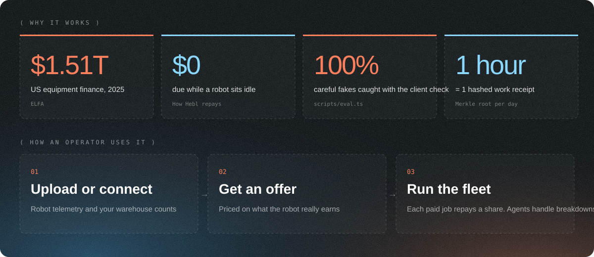
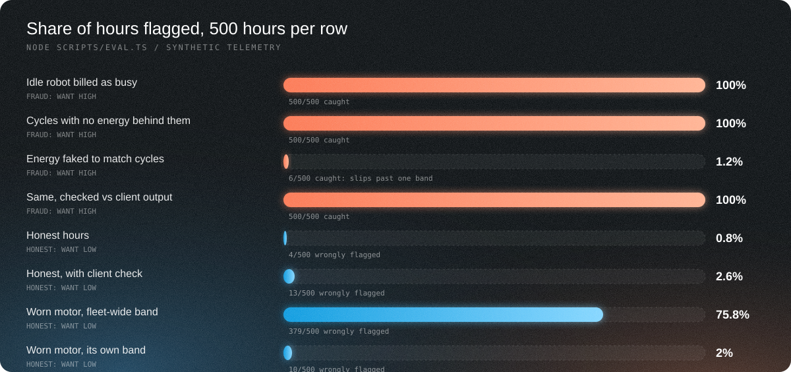
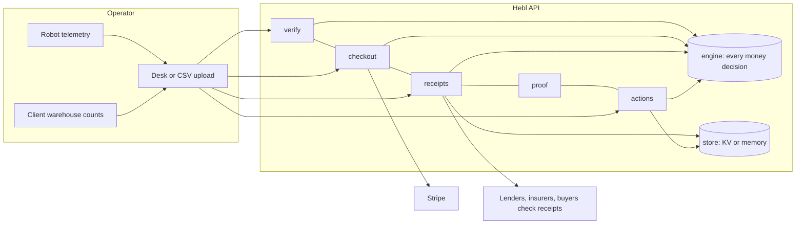
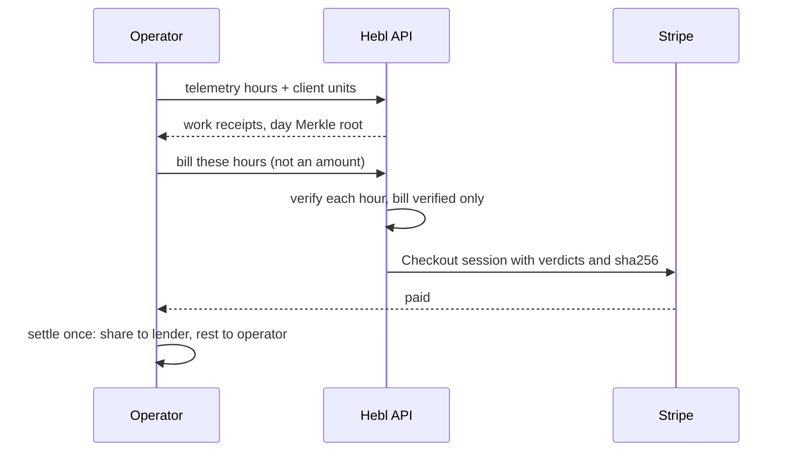

<div align="center">


**[Live product](https://selfmade-yc.vercel.app)** · [See it run](https://selfmade-yc.vercel.app/pipeline) · [Operator desk](https://selfmade-yc.vercel.app/desk) · [Back a fleet](https://selfmade-yc.vercel.app/invest) · [Judges' guide](docs/JUDGES_GUIDE.md) · [Releases](https://github.com/KarinaKKarinaK/c0mpile-YC/releases)

   

</div>

## The vision

Robots are joining the workforce. They lift, sort, weld and inspect, and they earn money doing it. But a robot cannot get credit for that work. Banks price it like a forklift: a fixed bill every month, whether it ran all month or sat broken.

**Hebl gives every working machine a credit record and a loan that moves with its work.** Telemetry proves each hour. The client's warehouse system confirms the output. A small share of every verified job repays the loan, and nothing is due when the robot is idle. When the balance hits zero, the operator owns the robot.

Start with robots. Then GPUs, solar arrays, EV fleets: **any machine that earns can borrow against what it earns.**



## How it works

| | Step | What happens | Where in the product |
|---|------|--------------|----------------------|
| 1 | **Connect** | Robot telemetry (cycles, energy) and the client's warehouse counts arrive | CSV upload on the landing page, `/api/verify` |
| 2 | **Verify** | Each hour must match its energy draw *and* the client's count. Idle or faked hours are rejected on the server | `/api/checkout`, `lib/engine.ts` |
| 3 | **Receipt** | Every hour becomes a sha256 work receipt; each day rolls into a Merkle root anyone can check | `/api/receipts`, `/api/receipts/proof` |
| 4 | **Repay** | The client pays through Stripe; a fixed share goes to the loan | `/api/checkout`, desk |
| 5 | **Handle breakdowns** | An agent proposes the service ticket, payment holiday and lender notice; two roles approve | `/api/actions`, desk |
| 6 | **Fund** | Lenders and qualified investors fund pools and are paid from the same verified work | `/invest` |

## The case for Hebl

### Why now
- Since **28 Jul 2026** the FCC no longer authorizes new foreign-made mobile robots ([DA 26-786](https://docs.fcc.gov/public/attachments/DOC-423682A1.pdf)). Robot values just changed, and lenders cannot price that from a credit score.
- Physical AI startups raised **$47.4B in H1 2026** ([Crunchbase](https://news.crunchbase.com/venture/physical-ai-funding-startups-robotics-aerospace-h1-2026/)), much of it equity spent on hardware that debt should fund.
- Robots already stream telemetry, and AI agents are now good enough to run collections and maintenance workflows.

### How big this gets
| Market | Size | Source |
|--------|------|--------|
| US equipment finance | **$1.51T** in 2025, 55.2% of equipment spend financed | [ELFA](https://www.supplychain247.com/article/industry_horizon_report_shows_equipment_finance_industry_expanded_to_1.5_trillion) |
| US industrial robot installs | **38,400** in 2025, +12% | [IFR](https://ifr.org/downloads/press_docs/EN-2026-SEP-24-IFR_Press_Release_WR-USA.pdf) |
| Revenue-share lending, proven | **81,000+** businesses funded by Stripe Capital | Stripe 2025 annual letter |

We start with robot fleet operators, a market of a few thousand companies, and grow into every financed machine.

### The questions we expect, answered
| Question | Answer |
|----------|--------|
| **Who has the problem?** | Fleet operators and robots-as-a-service companies that finance hardware and get hit by fixed payments in slow or broken months. |
| **How acute is it?** | One jammed line or one slow month turns a fixed payment into a missed payment. So young fleets burn equity on hardware instead. |
| **Who else is trying?** | Equipment banks (fixed, about 10.5%), Formic (robots as a service, finance bundled), USD.AI with Aravolta (GPU loans on telemetry, GPUs only), Stripe Capital (revenue share on card sales). In our scan we found no one pricing robot loans on live telemetry with repayment taken per job. |
| **What already works like this?** | Stripe Capital (repay as a share of sales), USD.AI (GPU loans on telemetry), aircraft and equipment lessors, revenue-based financing. |
| **How does it make money?** | A software fee per loan on licensed partner capital first, so we can start without a lending licence or our own balance sheet. Then our own credit line, then investor pools. |
| **How does it scale?** | Every verified hour improves pricing. Receipts compound into each machine's credit history, which is the moat. |
| **Why us?** | This is our fourth build on machines that pay their own way: a drone that repays its lease from verified work (Shenzhen FinTechathon), a robot training-data market (HK AI Summit, finalist, 2nd), and a rules ledger an AI agent cannot overrule (Nebius x NVIDIA). We are adding an equipment-finance advisor. |
| **Why for years?** | Machines are becoming economic actors. Someone has to build their credit system; we keep coming back to this problem. |
| **What if the loan business stalls?** | The work-receipt layer stands alone: insurers, buyers and lenders all need proof of what a machine actually did. |

## Ready to ship

| Ready today | Evidence |
|-------------|----------|
| Live product, end to end | [Run the pipeline](https://selfmade-yc.vercel.app/pipeline): receipts, verification, proof, billing, settlement, agent actions, approvals |
| Works with a customer's own data | Upload a `cycles,kwh` CSV; with 30+ rows the server fits that robot's own energy band |
| Server-side trust | Billing is computed from telemetry on the server; the Stripe session carries the verdicts and a sha256 of the hours; each session settles once |
| Measured fraud resistance | Table below, reproducible with `node scripts/eval.ts` |
| Engineering hygiene | 11 tests, CI on every push, typed API, input validation on every route |

| Next 30 days | |
|--------------|--|
| First fleet partner | 90 days of real uptime data under NDA |
| First lender partner | Fund 5 robots on Hebl rails |
| Live payments | Stripe Connect split at source; KV storage for receipts |

## Fraud resistance, measured



| Case | Flagged | Read it as |
|------|---------|-----------|
| Fraud: idle robot billed as busy | 500/500 | caught |
| Fraud: cycles with no energy | 500/500 | caught |
| Fraud: energy faked to match cycles | 6/500 | slips past one physics band |
| Same fake, checked against the client's confirmed output | 500/500 | caught by a second, independent source |
| Honest: normal physics | 4/500 | false flags |
| Honest, with the client check | 13/500 | the price of the extra check |
| Honest: worn motor, one band for the fleet | 379/500 | a fleet-wide band blocks real work |
| Honest: worn motor, its own fitted band | 10/500 | per-robot band fixes drift |

## Architecture





## API

| Route | Method | Purpose |
|-------|--------|---------|
| `/api/verify` | POST | CSV of `cycles,kwh` per hour; per-robot band; returns verified hours and an offer |
| `/api/checkout` | POST, GET | Bills from telemetry hours; Stripe session with verdicts and sha256; settles once |
| `/api/receipts` | POST, GET | Work receipts per hour; day Merkle root |
| `/api/receipts/proof` | GET | Inclusion proof for one receipt |
| `/api/actions` | POST, PATCH, GET | Agent proposals; distinct-role approvals; sha256 event chain |
| `/api/agent` | POST, GET | Model reads job offers and failure notes (GMI Cloud, OpenRouter, offline fallback) |
| `/api/market` | GET | Live robotics news scored into a resale index per robot type |

## What is real, what is simulated

| Layer | Status |
|-------|--------|
| Robot models and list prices | Sourced (`lib/models.ts`) |
| News feed | Live RSS; impact weights are ours [modelled] |
| Verification, billing, receipts, Merkle proofs, agent quorum | Real code, tested |
| Storage | KV store when `KV_REST_API_URL` is set; otherwise in memory per server instance |
| Stripe Checkout | Real code; live test keys pending, so the demo runs in labelled simulated mode |
| Fleet, hourly rates, telemetry in the demo | [synthetic] |
| Investor pools | Demo only, not an offer |

## Run it

```bash
npm install && cp .env.example .env.local && npm run dev
npm test                 # 11 tests
node scripts/eval.ts     # reproduces the fraud table
```

## Repository guide

| Path | What |
|------|------|
| `lib/engine.ts` | Every money decision: verification, settlement, receipts, Merkle proofs, agent rules, loans, covenants |
| `lib/store.ts` | KV or in-memory storage |
| `app/api/*` | The API above |
| `app/page.tsx`, `app/pipeline`, `app/desk`, `app/invest` | Landing, live pipeline, operator desk, Back a fleet |
| `components/Fleet3D.tsx` | 3D factory |
| `docs/EVALUATION.md` | Each claim mapped to its evidence and file |
| `docs/JUDGES_GUIDE.md` | Two-minute tour and commands to check the claims |
| [`/llms.txt`](https://selfmade-yc.vercel.app/llms.txt) | Plain-text summary for automated readers, following the llms.txt convention |

Every number in this README is sourced, measured by `scripts/eval.ts`, or labelled.

## Team

Karina Kalicka-Molin, Julian Mundelein. Built at c0mpiled-18, YC Startup School Hackathon, Taipei. Not affiliated with Y Combinator.
