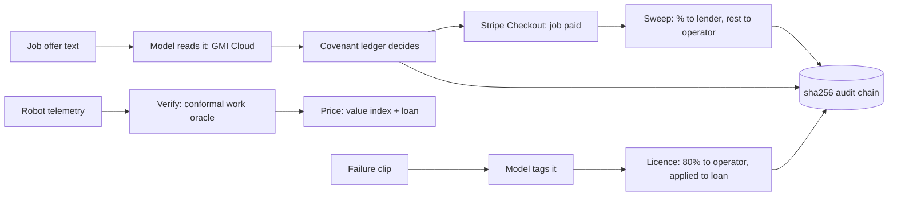
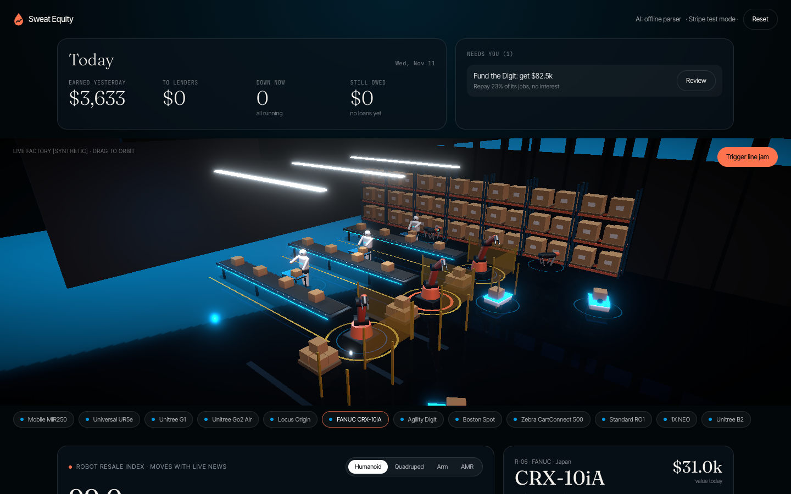

<div align="center">


# Selfmade

*Bot and paid for.*

**[Live demo: selfmade-yc.vercel.app](https://selfmade-yc.vercel.app)**


**500 / 500** spoofed hours caught | **2.4%** honest hours flagged | **0** robot lenders using live telemetry found
<sub>Oracle numbers measured on synthetic telemetry, 11 Nov 2026, `node scripts/eval.ts`. Lender search: our scan, see [Why it's different](#why-its-different).</sub>

</div>

Robot fleets borrow like it is 1995: a bank prices the robot like a forklift and wants the same payment whether it worked all month or sat broken. Selfmade lends against what a robot actually earns, reads that from the robot's own telemetry, and takes repayment as a share of every verified job through Stripe. A robot is the first asset with two cash flows, work and data, and we underwrite both.

Built in four hours at c0mpiled-18, the YC Startup School Hackathon in Taipei, for YC's Request for Startups **Wall Street for the Physical Buildout** (Brad Flora), with a hook into **Robots Made in America** (Diana Hu).

## Try it in two minutes
| Step | Where | What you see |
|------|-------|--------------|
| 1 | `/desk`, click a robot in the 3D fleet | Its value index, FCC status and our offer next to a 10.55% bank loan |
| 2 | Fund this robot | A `loan.funded` event lands in the sha256 audit chain |
| 3 | Job inbox, Offer 2, Read offer | The model reads the offer; covenant C1 blocks the $12/h job by name |
| 4 | Offer 1, Read offer | Accepted. With spoofed hours ticked, orange hours fail the telemetry check and are not billed |
| 5 | Collect with Stripe | Stripe Checkout (test card 4242 4242 4242 4242). On return, the sweep moves the loan balance |
| 6 | Tag and license clip | An edge-case failure becomes a data licence; 80% goes to the operator and pays the loan down |
| 7 | Covenant ledger | Lowering C1 needs both lender and operator; Apply stays disabled until two different people approve |
| 8 | Audit chain, Tamper, Verify | Editing event 0 is caught |

## Why it matters
- US equipment finance was **$1.51T** in 2025, with 55.2% of equipment spend financed ([ELFA via SupplyChain247](https://www.supplychain247.com/article/industry_horizon_report_shows_equipment_finance_industry_expanded_to_1.5_trillion)).
- Physical AI startups raised **$47.4B** in H1 2026 ([Crunchbase](https://news.crunchbase.com/venture/physical-ai-funding-startups-robotics-aerospace-h1-2026/)), much of it equity spent on hardware that debt should fund.
- Since 28 Jul 2026 the FCC no longer authorizes new foreign-made mobile robots, humanoids and quadrupeds; fixed arms are excluded ([FCC DA 26-786](https://docs.fcc.gov/public/attachments/DOC-423682A1.pdf)). YC's RFS: more than 65% domestic component cost, 75% in 2029 ([YC RFS](https://www.ycombinator.com/rfs)). That changes what a robot is worth. Our index prices it.
- YC's RFS, in one line: "Today, banks underwrite a robot like a forklift."

## Why it's different
| Who | What they do | What is missing |
|-----|--------------|-----------------|
| USD.AI + Aravolta (YC) | GPU loans with live GPU telemetry | GPUs only; no revenue sweep found |
| Formic | Robots as a service with bundled financing | An operator, not a lender |
| kineo finance | Asset financing for robot startups | No telemetry pricing found |
| Silicon Data, Ornn | GPU price indexes | No robot price index exists |

- **Repayment rides on revenue.** A share of each verified job, like Stripe Capital, so a slow month means a smaller payment, not a default.
- **Fake work is the fraud that kills asset lenders.** Every billed hour must match the robot's energy draw inside a calibrated band.
- **Rules the agent cannot overrule.** Covenants are a ledger; changing one takes two different people.
- **Two cash flows.** Edge-case clips are licensed to robot model labs; the operator keeps 80%.

## How it works

| # | Stage | What it does | Code |
|---|-------|--------------|------|
| 1 | Verify | Split-conformal band on energy vs cycles; idle or spoofed hours rejected | `lib/engine.ts` `calibrate`, `verifyHour` |
| 2 | Price | Value = half asset value, half income value, times health; -20% for non-compliant mobile robots [modelled] | `robotValue` |
| 3 | Lend | Advance 60% of value, one flat 12% fee, sweep 8 to 30% of revenue | `offerLoan`, `applyPayment` |
| 4 | Govern | Covenants checked in code; quorum of 2 distinct approvers to change | `checkJob`, `canChange` |
| 5 | Audit | Each event hashed with the previous hash; any edit breaks the chain | `append`, `verifyChain` |
| 6 | Read | Model turns messy offers and failure notes into JSON; code validates and decides | `app/api/agent/route.ts` |
| 7 | Pay | Stripe Checkout; only a session Stripe marks paid moves the loan | `app/api/checkout/route.ts` |

## What it looks like


## The numbers
| Metric | Ours | How measured |
|--------|------|--------------|
| Spoofed hours caught | 500 / 500 | `node scripts/eval.ts`, 500 synthetic spoofed hours (idle and no-energy shapes) |
| Honest hours wrongly flagged | 12 / 500 (2.4%) | same run, calibrated at alpha 0.02 on 500 separate honest hours |
| Tests | 7 passing | `npm test` |

The telemetry is synthetic, so the catch rate shows the mechanism works, not field accuracy. Field accuracy needs a fleet partner.

## Decisions are code: the model only reads
The model never moves money. It turns a job offer into `{task, hours, payPerHour, client}` and a failure note into `{tag, rarity}`. The server clamps every field, the covenant ledger decides, and licence prices come from a fixed table. If no key is set, an offline parser takes over and the UI says so.

## Built on GMI Cloud and Stripe
- **GMI Cloud**: OpenAI-compatible endpoint `https://api.gmi-serving.com/v1`, model set by `GMI_MODEL`. Used for reading job offers and tagging failure clips. Falls back to OpenRouter, then to the offline parser. Provider, model and latency are shown on screen.
- **Stripe**: Checkout in test mode for job payments. The return URL is checked server side with `checkout.sessions.retrieve`; nothing moves unless `payment_status` is `paid`. Next step: Stripe Connect to split the payout at source.

## What is real, what is simulated
| Layer | Status |
|-------|--------|
| Covenant ledger, two-person rule, sha256 chain | Real |
| Work oracle | Real code, synthetic telemetry |
| Model reading offers and clips | Real call when `GMI_API_KEY` is set; offline parser otherwise, labelled |
| Job payment | Real Stripe Checkout, test mode; simulated if no key, labelled |
| Fleet, prices, telemetry | [synthetic] |
| Value index, loan terms, FCC discount, licence prices | [modelled] / [target] |
| Bank comparison rate 10.55% | Example bank equipment rate from our research |

## Run it locally
```bash
npm install
cp .env.example .env.local   # optional: GMI, OpenRouter, Stripe test keys
npm run dev                  # http://localhost:3000
```

## Commands
| Task | Command |
|------|---------|
| Test | `npm test` |
| Oracle numbers | `node scripts/eval.ts` |
| Build | `npm run build` |

## Stack
Next.js 16, React 19, Tailwind 4, three.js with react-three-fiber and drei, Stripe, GMI Cloud. Fonts: Instrument Serif and Space Mono.

## Repository layout
| Path | What |
|------|------|
| `lib/engine.ts` | Every money decision: oracle, value, loan, covenants, audit chain |
| `lib/engine.test.ts` | Tests |
| `app/page.tsx`, `components/BeadCurtain.tsx` | Landing page and the bead-curtain hero |
| `app/desk/page.tsx`, `components/Fleet3D.tsx` | Lending desk and 3D fleet |
| `app/api/agent`, `app/api/checkout` | Model and Stripe routes |
| `scripts/eval.ts` | Prints the measured oracle numbers |

## Known limits
- No real robots yet: telemetry, prices and the fleet are synthetic.
- The loan is not funded with real money; Selfmade would start as the underwriting layer for licensed equipment lenders.
- State lives in the browser (localStorage) for the demo.
- The FCC discount is a modelled assumption, not market data.

## Team
Karina Kalicka-Molin.

## License
All rights reserved.
